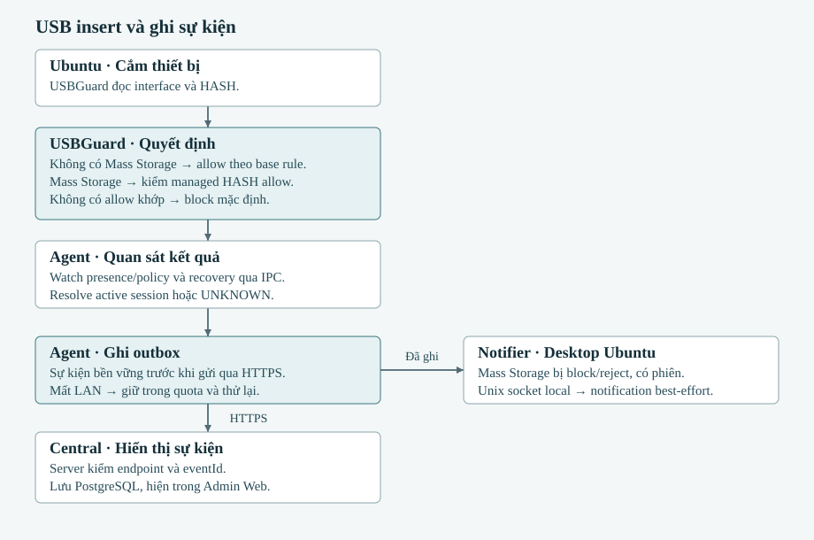
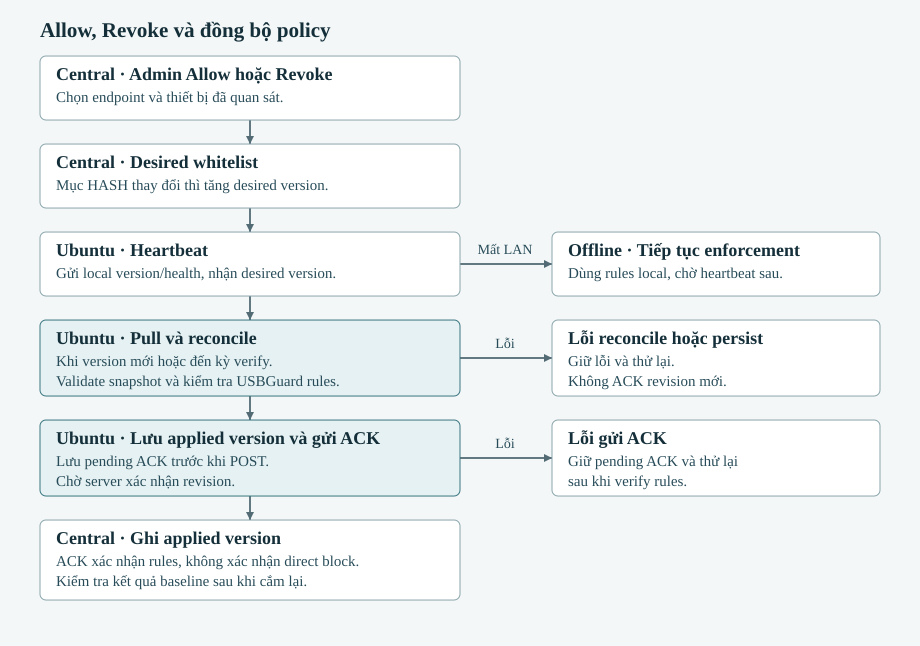

# Kiến trúc

## Runtime tại baseline

Windows chạy Nginx, Spring Boot và PostgreSQL. Nginx kết thúc TLS và kiểm tra CIDR. Cấu hình mẫu chuyển tiếp đến Spring Boot ở loopback. React/Vite có thể được đóng gói trong cùng JAR thông qua Maven profile `with-frontend`. PostgreSQL lưu tài khoản, endpoint, thiết bị, sự kiện và danh sách cho phép theo endpoint. Flyway quản lý schema.

Ubuntu chạy USBGuard và Agent systemd dưới tài khoản dịch vụ `usbshield`. USBGuard quyết định trên thiết bị bằng rules đã nạp. Agent dùng gateway để quan sát, quản lý allow rules theo HASH và kiểm tra rules sau reconcile. Tách gateway khỏi đồng bộ HTTP để test được contract và failure path bằng test double. Helper trong phiên desktop nhận thông báo qua Unix socket local. Việc không có phiên phù hợp hoặc thông báo lỗi có thể làm mất thông báo desktop trong khi USBGuard vẫn xử lý thiết bị.

| Ranh giới | Hành vi source |
| --- | --- |
| LAN → central | HTTPS tại Nginx. Mạng Client được vào các route Agent theo ACL. Admin Web/API cần đường mạng Admin. |
| Admin → Server | Spring Security session/CSRF và `ROLE_ADMIN`. Baseline dùng dữ liệu quản trị chung. |
| Agent → Server | Enrollment dùng secret bootstrap. Các request tiếp theo dùng endpoint ID và Agent token. Agent không có quyền Admin. |
| Agent → USBGuard | IPC ACL riêng cho service account. Daemon áp dụng rules local. |
| Agent → notifier | IPC local cho thông báo đến desktop user. Active session là attribution tốt nhất có thể, có thể là `UNKNOWN`. |

## USB insert, enforcement và sự kiện

USBGuard cho thiết bị không có interface Mass Storage đi qua base allow rule. Thiết bị storage dùng managed allow rule theo HASH hoặc rơi vào mặc định block. `UsbGuardEventListener` kết hợp presence và policy event. Khi tín hiệu watch thiếu hoặc mất, listener có đường recovery qua snapshot IPC. `EventSenderService` ghi sự kiện vào outbox. Server xác thực endpoint và xử lý retry theo `eventId`. Khi LAN gián đoạn, USBGuard tiếp tục dùng rules local và Agent giữ sự kiện trong giới hạn outbox. Khi phục hồi kết nối, heartbeat cycle gọi drain. Luồng live watch thử gửi thông báo sau khi ghi sự kiện liên quan vào outbox, với điều kiện Mass Storage bị block/reject, có phiên được resolve và IPC còn dùng được.

## Admin Allow, Revoke và đồng bộ policy

Allow được xác thực theo endpoint đã báo thiết bị và HASH hợp lệ. Revoke tắt mục whitelist theo endpoint. Server tăng desired version khi thực sự thay đổi. Agent heartbeat gửi version local và health, pull snapshot khi version đổi hoặc đến kỳ verify, rồi validate toàn bộ snapshot, reconcile và kiểm tra rules. Agent lưu applied version và pending ACK trước khi gửi ACK. ACK hỏng được thử lại sau khi verify. Khi endpoint mất LAN, desired version có thể đi trước applied version. Baseline Allow/Revoke cần rút và cắm lại để kiểm tra kết quả trên thiết bị đang cắm. ACK chỉ cho biết revision rules đã áp dụng theo contract hiện tại.

## Mục tiêu v2.5

[Blueprint](../BLUEPRINT.md) quy định JavaFX trên Windows, một workspace sở hữu endpoint, vận hành không cần Internet khi LAN còn, và giữ policy/outbox local khi mất LAN. Revoke mục tiêu chặn USB đang cắm khi Agent nhận và thực thi policy, với kết quả actual block riêng và retry khi lỗi. Allow mục tiêu vẫn cần rút/cắm lại. File monitoring và bộ cài Windows tích hợp là các slice sau. Thiết kế chi tiết cần ADR và quyết định Owner.
