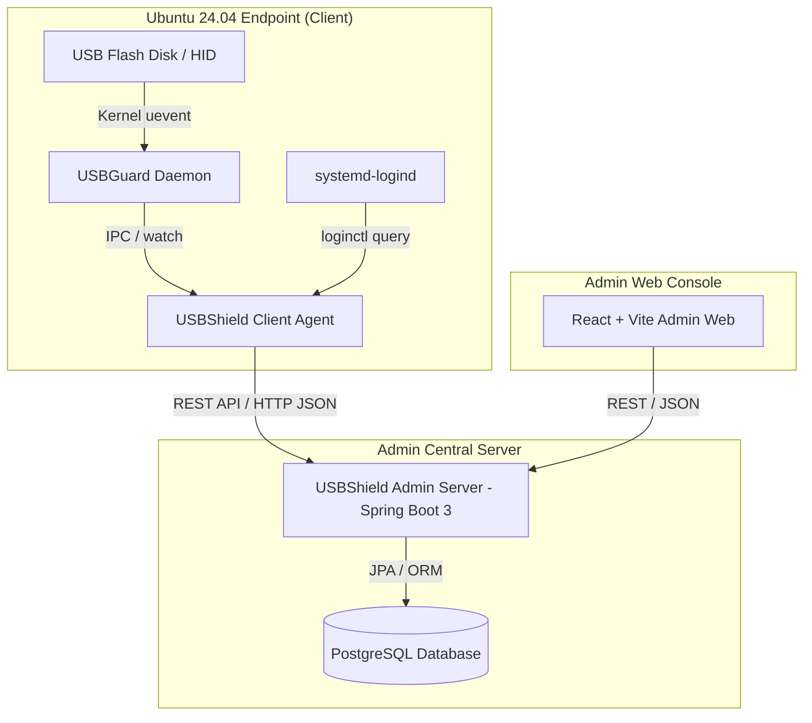
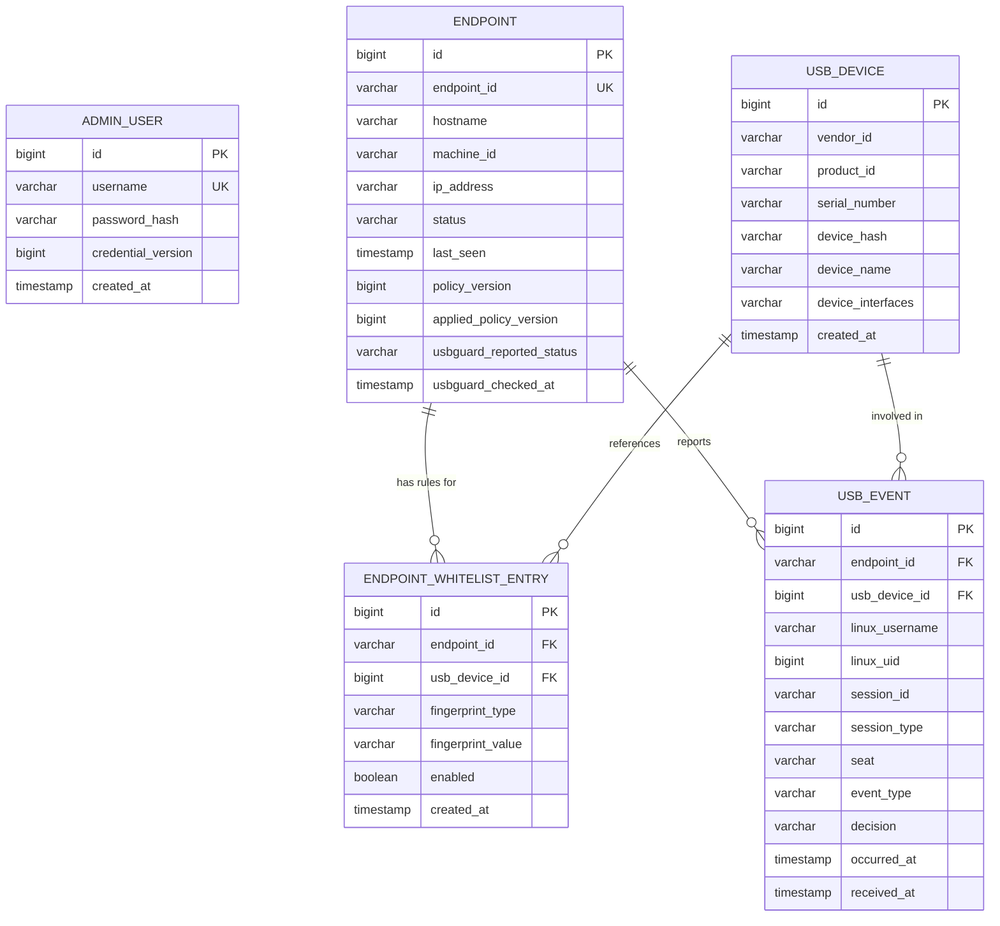

> **Current runtime (04/11/2026):** `vinhkhang` `035b8ed5a4f5b111dace06cf839cf5f1c33f1142` uses **PostgreSQL** as the Admin Server's central database. The dated Week 1–4 H2 implementation reports below are retained as historical snapshots, not current design decisions. The Java JAR and Ubuntu `.deb` artifact types are unchanged. See [RUN_GUIDE.md](RUN_GUIDE.md).

# USBShield Ubuntu — System Architecture Document (v0.1)

> **Dự án:** USBShield Ubuntu — Hệ thống ngăn chặn và quản lý USB Flash Disk trên Ubuntu  
> **Tài liệu:** Kiến trúc hệ thống tổng thể (System Architecture Document)  
> **Phiên bản:** v0.1 (Week 1 Contract Freeze)  
> **Owner:** Member 1 (Admin Server Lead & Architecture/Integration Owner)  

---

## Implementation update — 04/11/2026 (supersedes historic runtime notes)

```text
Admin workstation (allowed source IP) -- TLS/443 --> Nginx ACL --> Admin Web, /api/auth/**, /api/admin/**
Ubuntu Agent (allowed client source IP) -- TLS/443 --> Nginx ACL --> /api/agent/** only
                                                            |
                                                     127.0.0.1:18080
                                                            |
                                                      Spring Boot JAR
                                                            |
                                              PostgreSQL (Flyway V1/V2)
```

- **Tách ACL và authentication:** Nginx giới hạn IP/route; Spring Security vẫn bắt buộc Admin session/CSRF và endpoint-bound Agent credentials. Client bị chặn tải static SPA; backend HTTP chỉ bind loopback. Tránh bypass proxy, untrusted forwarded headers hoặc gộp source NAT. Rate limiting **không được triển khai** theo quyết định owner.
- **Chính sách USB:** Agent `live` chỉ chấp nhận HTTPS với CA/hostname validation, không fallback HTTP/redirect hay storage tương đối. Server validate HASH, Agent validate *toàn bộ* whitelist trước USBGuard; malformed policy không ACK. Event offline giữ được nếu timestamp không vượt ngưỡng tương lai.
- **Trạng thái bảo vệ:** heartbeat có báo cáo USBGuard thật, khác với liveness và `appliedPolicyVersion` (ACK). Admin Web dùng bốn trạng thái `HEALTHY/DEGRADED/UNAVAILABLE/UNKNOWN`, checkedAt/staleness, heartbeat và version match. Đây là *Agent-reported* health, không phải chứng thực vật lý độc lập từ Server.
- **Schema:** Flyway V1 khởi tạo tables, V2 thêm `admin_users.credential_version`, `endpoints.usbguard_reported_status`, `endpoints.usbguard_checked_at`; Hibernate `validate`. `usbshield_test`/`usbshield_browser_test` dùng test-only schemas ngẫu nhiên. Database hiện hữu cần baseline V1 một lần sau backup/preflight; không tự baseline.
- **Read models:** `/api/admin/endpoints/page` và `/api/admin/whitelist/page` lọc/phân trang tại PostgreSQL, giảm N+1 HTTP; Endpoint detail và per-endpoint Allow/Revoke vẫn scoped, không có global Allow.

Chi tiết: [RUN_GUIDE.md](RUN_GUIDE.md), [Phase 3 HTTPS/ACL/Paging](PHASE3_HTTPS_ACL_AND_PAGING.md), [Implementation status](IMPLEMENTATION_STATUS_20261104.md).

## Week 2 implementation update — v0.2 (2026-10-16)

Admin Server now separates session/CSRF-protected Admin APIs from endpoint-token
Agent APIs. Token hashes are stored centrally, with endpoint binding. Enrollment
has a configured bootstrap secret and rejects duplicate machine registration.
Per-endpoint whitelist writes and ACK use transactional endpoint row locks.
Heartbeat is telemetry only; applied version changes through validated ACK.
Policy wire field is `whitelistedDevices` (v0.2). See [API](API.md) for exact DTOs,
paging, HASH-only grants, errors, startup and cross-member handoff.

Historical Week 2 H2 update was additive for credential hash/event hostname and machineId uniqueness;
existing DB validation and deployment limits are documented in the
[server integration report](member1/WEEK2_SERVER_INTEGRATION.md).
Week 1 remains closed. Backend test results do not establish Ubuntu physical USB,
client notification or integrated Web Gate completion.

## 1. Tổng quan hệ thống (System Overview)

USBShield Ubuntu là giải pháp bảo mật Endpoint tập trung dành cho hệ điều hành Ubuntu (mục tiêu chính: Ubuntu 24.04 LTS amd64), giải quyết triệt để 2 bài toán cốt lõi:
1. **Ngăn chặn phần cứng:** Tự động chặn các thiết bị USB Flash Disk (Mass Storage - class `08`) chưa được cấp phép, đồng thời duy trì hoạt động bình thường của chuột/bàn phím (HID - class `03`).
2. **Active User Attribution:** Ghi nhận chính xác tài khoản Ubuntu có phiên đăng nhập local đang active tại thời điểm cắm USB, gửi cảnh báo về Admin Server trung tâm kèm quyết định `ALLOWED` hoặc `BLOCKED`.

Hệ thống hoạt động theo mô hình Client-Server tập trung trong mạng LAN (phòng lab, trường học, doanh nghiệp).



---

## 2. Các nguyên tắc kiến trúc cốt lõi (Core Architectural Principles)

### 2.1. Fail-Closed Principle (Nguyên tắc mặc định chặn)
- Base policy thực tế trong `packaging/usbguard/rules-v0.1.conf` dùng `allow with-interface none-of { 08:*:* }`: cho phép thiết bị không có Mass Storage interface, bao gồm chuột/bàn phím class `03` và các ngoại vi không lưu trữ khác.
- Thiết bị có Mass Storage interface (class `08`), kể cả composite Storage + HID, không khớp rule trên. Nếu không có rule allow cụ thể cho thiết bị đó, `ImplicitPolicyTarget=block` sẽ **BLOCK**. Các rule whitelist phải được tạo và duy trì riêng cho đúng endpoint.
- **Khả năng tự trị khi mất mạng (Offline Resilience):** Khi Agent mất kết nối tới Admin Server, daemon USBGuard trên máy trạm vẫn thực thi chính sách đã lưu cục bộ (`/etc/usbguard/rules.conf`). Agent sẽ spool các sự kiện vào outbox cục bộ và đồng bộ lại khi kết nối phục hồi.

### 2.2. Per-Endpoint Whitelist (Chính sách Whitelist theo máy trạm)
- **Tuyệt đối không sử dụng Global Whitelist (Allow-All):** Mỗi thiết bị USB khi được quản trị viên duyệt chỉ được cấp phép cho một hoặc một tập Endpoint cụ thể (`endpoint_id + device_identity`).
- **Ngăn ngừa rủi ro lây lan:** Một USB được whitelist tại máy Lab-01 không thể tự động cắm được vào máy Lab-02 trừ khi Admin chủ động gán quyền trên máy đó.
- **Phiên bản hóa chính sách (Policy Versioning):** Mỗi Endpoint có một số phiên bản chính sách `policyVersion` (Desired) và `appliedPolicyVersion` (Applied). Khi Admin thay đổi whitelist của máy nào, `policyVersion` của máy đó tăng lên 1, kích hoạt Agent kéo bản cập nhật qua cơ chế Heartbeat.

### 2.3. Active User Attribution (Định danh người dùng tại thời điểm sự kiện)
- USBShield xác định tài khoản Ubuntu local đang tương tác trực tiếp với máy tại khoảnh khắc USB được cắm thông qua `systemd-logind`.
- **Thông tin thu thập:**
  - `linuxUsername`: Tên tài khoản Ubuntu (VD: `student01`, `usbdev`).
  - `linuxUid`: User ID tương ứng (VD: `1000`).
  - `sessionId`: Mã session từ logind (VD: `2`, `21`).
  - `sessionType`: Loại session đồ họa (`wayland`, `x11`, hoặc `tty`).
  - `seat`: Vị trí tương tác phần cứng (mặc định `seat0`).
- **Fail-safe Ambiguity Rule:** Nếu tại thời điểm cắm USB không có session local active duy nhất (máy đang ở màn hình khóa, nhiều user SSH, hoặc không xác định rõ), hệ thống gán nhãn `UNKNOWN`. **Tuyệt đối không tự đoán mò (do not guess).**
- *Giới hạn kỹ thuật:* Hệ thống xác định phiên đăng nhập phần mềm active, không chứng minh bằng cơ học ai là người cầm tay cắm thiết bị.

---

## 3. Phân rã cấu trúc các thành phần (Component Breakdown)

| Thành phần | Công nghệ | Nhiệm vụ chính |
| :--- | :--- | :--- |
| **Client Agent** (`client-agent`) | Java 21, Spring Boot, systemd service | Lắng nghe sự kiện từ USBGuard IPC, tra cứu session active qua logind, gửi heartbeat/event lên Server, đồng bộ whitelist vào USBGuard rules. |
| **Admin Server** (`admin-server`) | Java 21, Spring Boot 3.3.x, Spring Data JPA, Security, PostgreSQL | Quản lý định danh Endpoint, lưu trữ lịch sử sự kiện, quản trị Per-endpoint Whitelist, cung cấp REST API cho Agent và Web Console. |
| **Admin Web Console** (`frontend`) | React, Vite, TypeScript | Giao diện dashboard cho quản trị viên theo dõi sự kiện thời gian thực, duyệt whitelist, xem trạng thái kết nối các máy trạm. |
| **Packaging & Enforcement** (`packaging`) | Debian package (`.deb`), USBGuard daemon | Đóng gói cài đặt trọn gói trên Ubuntu 24.04 LTS, cấu hình systemd service tự chạy và bảo vệ chống tắt trái phép. |

---

## 4. Mô hình dữ liệu quan hệ (Entity Data Model - PostgreSQL)

Admin Server dùng PostgreSQL qua JDBC/Spring Data JPA. Dữ liệu tồn tại bền vững trên PostgreSQL service/data directory qua restart JAR; không phụ thuộc file H2 cục bộ. Các bảng Admin account, endpoint, device, event và per-endpoint whitelist do **Flyway V1/V2** tạo/nâng cấp; Hibernate chỉ `ddl-auto=validate`, không tự `update` schema. Database `usbshield` và role ứng dụng được tách khỏi `usbshield_test`/`usbshield_browser_test` phục vụ kiểm thử:



---

## 5. Luồng xử lý tích hợp (Integration Workflows)

### 5.1. Luồng phát hiện & chặn USB (Detection & Ingestion Flow)
1. Người dùng cắm USB vào máy trạm Ubuntu.
2. Kernel nhận diện và USBGuard daemon kích hoạt quy tắc kiểm tra.
3. Thiết bị không có class `08` khớp base allow rule. Mass Storage chưa có rule allow cụ thể sẽ rơi vào implicit **BLOCK** ở tầng nhân.
4. `UsbGuardEventListener` trong Client Agent bắt được tín hiệu từ `usbguard watch`.
5. `ActiveUserResolver` truy vấn `systemd-logind` để lấy session local đang active (user, uid, session type).
6. Client Agent đóng gói `AgentEventRequest` và gửi `POST /api/agent/events` với cả `X-Endpoint-Id` và `X-Agent-Token` tới Admin Server.
7. Admin Server lưu trữ sự kiện vào bảng `usb_events` và thông báo tới Admin Console.

### 5.2. Luồng đồng bộ chính sách (Policy Synchronization Flow)
1. Client Agent định kỳ gửi `POST /api/agent/heartbeat` (mặc định 5 giây trong cấu hình Agent, có thể điều chỉnh), với `currentPolicyVersion` và hai header xác thực `X-Endpoint-Id`/`X-Agent-Token`.
2. Admin Server kiểm tra nếu `desiredPolicyVersion > currentPolicyVersion`, phản hồi desired version để Agent quyết định đồng bộ.
3. Client Agent gọi `GET /api/agent/policy` kèm cả `X-Endpoint-Id` và `X-Agent-Token`; cặp credential xác thực và giới hạn request vào một endpoint.
4. Admin Server chỉ trả về danh sách Whitelist được gán riêng cho máy đó.
5. Client Agent reconcile bằng CLI USBGuard (`append-rule`, `remove-rule`) qua daemon IPC; ứng dụng Java không tự sửa trực tiếp `rules.conf` hoặc restart daemon trong luồng này. USBGuard quản lý lưu quy tắc theo cấu hình RuleFile/RuleFolder; cần xác nhận persistence qua reboot trên Ubuntu thật.
6. Client Agent gửi `POST /api/agent/policy/ack` với cùng cặp header xác thực, chỉ sau khi đã áp dụng thành công phiên bản mới.

---

## 6. Kế hoạch theo tuần (lịch sử dự án; xem `RUN_GUIDE.md` để chạy hiện tại)

- **Week 1 (lịch sử):** Khởi tạo Server skeleton, H2 file DB ở thời điểm đó, Freeze DTO & Schema hợp đồng, Unit Test Jackson Parser. **Hiện tại dùng PostgreSQL**.
- **Week 2:** Kết nối Agent ↔ Server thực tế, xử lý outbox spool khi mất mạng, triển khai logic Per-endpoint Whitelist Admin CRUD.
- **Week 3:** Hoàn thiện giao diện Admin Web Console (React), xác thực Admin Session, hoàn thiện gói `.deb` cài đặt Ubuntu.
- **Week 4:** Kiểm thử toàn diện trên phần cứng thật (Flash Disk, Chuột, Bàn phím), đóng gói tài liệu báo cáo và chuẩn bị kịch bản Demo.


## Week 3 M1 handoff — 2026-10-23

Contract unchanged: v0.2 routes/JSON and desired/applied/ACK semantics remain.
Server adds a production profile, packaged React same-origin delivery and known-path
redirects to the existing hash router. Fresh endpoints remain OFFLINE until heartbeat;
corrupt Agent credentials fail closed. See [API deployment addendum](API.md) and
[Week 3 server report](member1/WEEK3_SERVER_HARDENING.md). Windows verification and
Ubuntu/USB/GUI/systemd/install/reboot deferred work are recorded separately.

## Week 4 M1 server freeze and deployment boundary — 2026-11-01

The Admin Server API remains frozen at v0.2: Admin session/CSRF is separate from
Agent endpoint-token authentication; each Agent token is bound to one endpoint;
whitelist intent is per endpoint; and desired policy is distinct from the
Agent-reported applied version. Heartbeat updates liveness only. See the canonical
[API freeze](API.md#week-4-apidto-freeze-v02) and [Developer Guide](DEVELOPER_GUIDE.md).

The `prod` profile requires externally supplied DB URL/password and enrollment
bootstrap token, creates an Admin account only when an initial password is
configured, binds to loopback by default, sets Secure/HttpOnly/SameSite session
cookies, disables Swagger/OpenAPI, and does not trust forwarded
headers. Remote browser access therefore requires HTTPS termination at a trusted
reverse proxy. The server JAR serves the React build and `/api` on the same origin.
PostgreSQL data/backup and runtime credentials belong in protected storage outside
Git; PostgreSQL runs as an independently managed service. There is one Admin Server,
no implemented clustering, HA or tested failover. Separate QA databases are used
for destructive integration/browser tests.

Week 4 Windows/JAR evidence and open release dependencies are tracked in
[M1 Week 4 handoff](member1/WEEK4_SERVER_HANDOFF.md). None of that evidence claims
physical USB, USBGuard daemon, systemd, desktop notification, Ubuntu installation,
or reboot execution.
