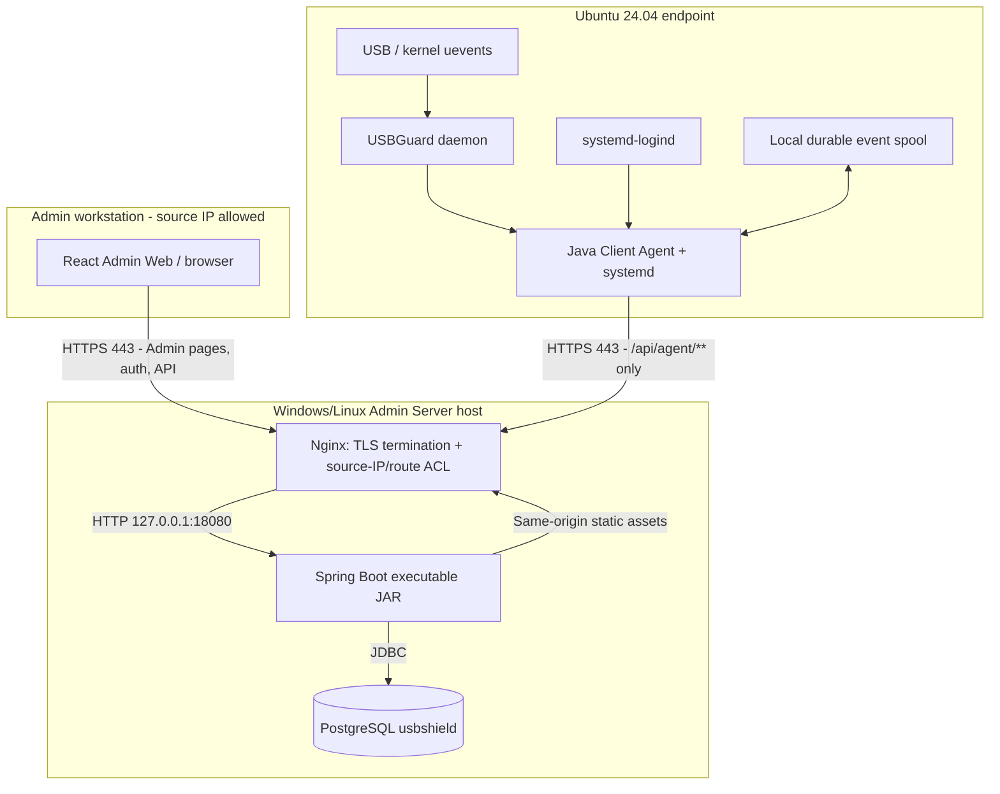
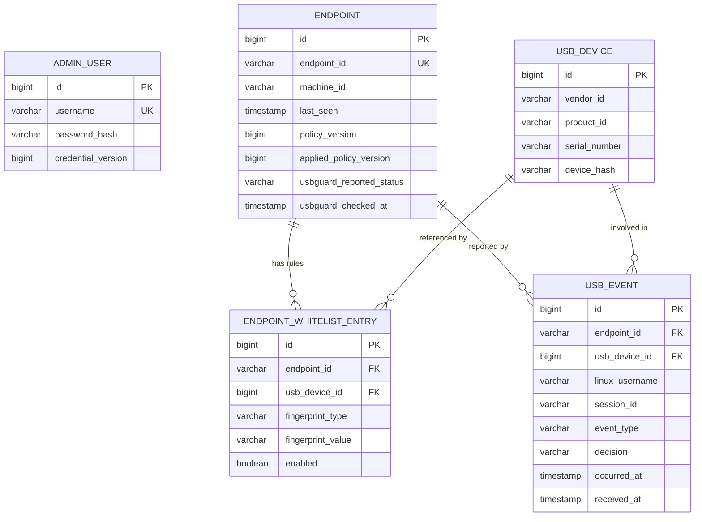

# USBProtection — System Architecture (current runtime, 20/11/2026)

> **Source inspected:** `main` `c7381fc7b9ba34aa561083431ce7c68b9a514a51`. This document describes the current design boundary, **not a fresh Windows/Ubuntu acceptance result**. The earlier architecture v0.1/Week 1–4 notes remain in Git history and the dated files under `docs/member1/`, `docs/qa/`, `docs/usbguard/` and `docs/client-agent/`. For operations use [RUN_GUIDE.md](RUN_GUIDE.md), for executable JAR releases use [ADMIN_SERVER_RELEASE.md](ADMIN_SERVER_RELEASE.md), for wire contracts use [API.md](API.md) plus the [Phase 1–3 addendum](API_PHASE1_TO_PHASE3_ADDENDUM.md).

## 1. Tổng quan hệ thống (System Overview)

USBShield quản lý chính sách USB Mass Storage (USB interface class `08`) trên các Ubuntu 24.04 LTS amd64 endpoints. Admin Server quản lý danh tính endpoint, lịch sử và whitelist theo **từng endpoint**; USBGuard chạy **tại Client** là thành phần thực thi quyết định trên máy. Admin Web chỉ gửi thao tác đến Server. Hệ thống không chứng minh được người đã trực tiếp cắm thiết bị; nó ghi nhận phiên Ubuntu local active liên quan đến thời điểm event hoặc `UNKNOWN` nếu không xác định được.

In the documented LAN setup, Nginx, Spring Boot and PostgreSQL can be on one host; upstream HTTP must remain **loopback-only**. When separated across hosts, secure the upstream separately. `18080` is a **deployment value set by `PORT`**, not the JAR's immutable default: `application-prod.yml` otherwise defaults to `8080`. A different hostname/port must be reflected consistently in Nginx, firewall, DNS/CA and runtime environment.

## 2. Các nguyên tắc kiến trúc cốt lõi (Core Architectural Principles)

### 2.1. Fail-Closed Principle (Nguyên tắc mặc định chặn)

- Base USBGuard rule in `packaging/usbguard/rules-v0.1.conf` allows devices **without** interface `08:*:*`, preserving non-storage/HID when permitted by policy. A composite device containing Mass Storage does **not** pass the generic non-storage rule. Without a specific whitelist rule, `ImplicitPolicyTarget=block` blocks USB storage.
- Client-side enforcement is independent of Admin Web availability; during a network outage, the installed USBGuard rules continue operating. The Agent has a durable event outbox for reconnect scenarios, but successful physical offline/reboot recovery requires separate native E2E evidence.
- A failure to fetch/validate a policy must not be interpreted as permission to allow unknown storage. Agent live mode rejects insecure HTTP, invalid certificate/hostname, or invalid durable configuration; it must not silently fall back to HTTP.

### 2.2. Per-Endpoint Whitelist (Chính sách Whitelist theo máy trạm)

- Whitelist grants are scoped by endpoint and strong USB identity/fingerprint; `Allow A` never implies `Allow B`.
- Server has desired `policyVersion` and Agent-reported `appliedPolicyVersion`. **Heartbeat cannot advance applied version; only validated `POST /api/agent/policy/ack` can.** An ACK does not independently attest that a physically attached USB has changed status.
- Policy changes **do not require immediate modification of a USB still connected**. After Agent sync/ACK, unplug/reinsert the device to test the resulting Allow/Revoke decision.
- To prevent partial acceptance, the Agent validates the entire policy before applying it. Invalid HASH/identity or inconsistent payload must not yield a successful ACK.

### 2.3. Active User Attribution (Định danh người dùng tại thời điểm sự kiện)

The Agent queries `systemd-logind` to attribute an event to the locally active GUI session when determinable: `linuxUsername`, `linuxUid`, `sessionId`, `sessionType` and `seat`. If attribution is missing or ambiguous, use **`UNKNOWN`**, not a guessed identity; SSH activity alone is not proof of the local physical user. Source `occurredAt` and Server `receivedAt` are separate timestamps. The Server validates unreasonable future timestamps while accepting legitimately older offline events.

### 2.4. Trust boundaries

| Boundary | Enforcement / evidence |
|---|---|
| Admin browser → Nginx → Admin API | Trusted HTTPS certificate, route/source IP ACL; Spring Admin session cookie + CSRF for mutations |
| Ubuntu Agent → Nginx → Agent API | Trusted HTTPS/SAN/CA; bootstrap enrollment token, then endpoint-bound `X-Endpoint-Id` and `X-Agent-Token` |
| Nginx → Spring Boot | HTTP loopback only on same host; no direct Client bypass |
| Spring Boot → PostgreSQL | Dedicated application role/db `usbshield`; schema Flyway; network DB port not opened for Client |
| Agent → USBGuard | Local daemon/IPC/rules; privilege separation and native audit required for physical enforcement |
| Test harness → PostgreSQL | `usbshield_test` / `usbshield_browser_test` and isolated temporary schemas only; **never** app database |

Nginx ACL uses the **actual network source IP**, not a client-supplied forwarded header; shared NAT can make Admin/Client source indistinguishable. Do not open Admin Web/Auth or static SPA to Client IPs when the deployment requires network separation. No rate limiting was implemented per owner scope; that leaves residual brute-force risk from allowed sources.

## 3. Phân rã cấu trúc các thành phần (Component Breakdown)

| Folder | Runtime / build technology | Responsibility |
|---|---|---|
| `admin-server/` | Java 21 target, Spring Boot 3.3.x, Spring Security, Spring Data JPA, Flyway | Auth/session, endpoint and Agent credentials, heartbeat/health projection, policy/version/ACK, USB events and read APIs |
| `frontend/` | React, TypeScript, Vite | Admin Web SPA. Build assets copied into executable JAR via Maven `with-frontend` profile; browser and API share HTTPS origin at runtime |
| `client-agent/` | Java 21 target, systemd on Ubuntu | USBGuard event/watch, local active user attribution, policy reconcile, durable offline queue and authenticated Agent transport |
| `packaging/` | `.deb`, systemd unit/config, Nginx sample, PowerShell/Linux tests | Agent installation; USBGuard policy, service lifecycle, HTTPS/ACL sample, verification/build tools |
| `scripts/with-env.ps1` | PowerShell | Loads an explicitly named `.env`-style file into the launched command's environment, **not into the JAR** |
| `admin-server/build-release.ps1` | PowerShell | Rebuild React/JAR, run test by default, validate classes/assets/migrations and produce versioned JAR + SHA-256/manifest |
| `packaging/tests/verify-windows.ps1` | PowerShell 7.6+ | Windows regression gates including Maven/frontend/browser-live, JAR and optional Agent/`.deb` checks; **not Ubuntu hardware E2E** |

The Admin Server JAR requires **Java 21+**, PostgreSQL and externally provided runtime configuration, but does not require source, Maven or Node/npm on a recipient's machine. Packaging the JAR or producing a checksum does not deploy TLS/Nginx/CA/ACL or configure PostgreSQL on behalf of the recipient.

## 4. Mô hình dữ liệu quan hệ (Entity Data Model - PostgreSQL)

- `usbshield` is the persistent application database. `usbshield_test` is for Admin Maven tests, `usbshield_browser_test` is for browser/HTTP-live tests; test role `usbshield_test` must be unable to alter the application DB.
- Flyway **V1/V2** migrates schema and Hibernate uses **`ddl-auto=validate`**. `baseline-on-migrate=false`, `clean-disabled=true`; **fresh empty DB:** auto-migrate. **Existing unversioned DB:** explicit backup/preflight/one-time baseline per [POSTGRES_FLYWAY_BASELINE.md](../admin-server/ops/POSTGRES_FLYWAY_BASELINE.md). Never baseline test DBs or reset production tables.
- Core persisted concepts: Admin account (`credential_version` for invalidating sessions), enrolled endpoint and hashed Agent credential, USB device/fingerprint catalog, endpoint-specific whitelist entry, USB events with local-user and temporal attribution, desired/applied policy versions and USBGuard reported status/checkedAt.

This is a **conceptual** ER diagram: table definitions, nullability and constraints are authoritative in `admin-server/src/main/resources/db/migration/V*.sql`, not inferred from the diagram.

## 5. Luồng xử lý tích hợp (Integration Workflows)

### 5.1. Luồng phát hiện & chặn USB (Detection & Ingestion Flow)

1. Ubuntu kernel and USBGuard evaluate the connected USB against local rules; unknown Mass Storage is blocked, non-storage follows its base rule.
2. The Java Agent reads USBGuard events via local watch/IPC and retrieves the active local login session from logind. If ambiguous, mark attribution `UNKNOWN`.
3. The Agent persists/retries event data when transport is unavailable and sends authenticated `POST /api/agent/events` over HTTPS when possible.
4. Server validates authenticated endpoint, event fields and times, persists the event, and exposes it through paginated Admin APIs.
5. Admin Web shows current Server-side data; UI status alone does not prove physical USB authorization.

### 5.2. Luồng đồng bộ chính sách (Policy Synchronization Flow)

1. Admin uses endpoint detail to Allow/Revoke one known USB on one endpoint.
2. Server updates endpoint-scoped whitelist and increments desired version.
3. Agent heartbeat reports liveness, current policy version and USBGuard health; it does **not** acknowledge a new version.
4. Agent obtains its authenticated policy and validates all entries before reconciling with USBGuard via daemon IPC/CLI.
5. Only after successful apply does the Agent send policy ACK. Server validates ACK (no future/regressive version).
6. Operator verifies by **unplug/reinsert** on Ubuntu A and B to distinguish actual policy behavior from API acknowledgement.

### 5.3. Admin Web rendering and read paths

Admin Web and Admin API run behind the **same HTTPS origin**. Endpoint list and global whitelist use backend filter and bounded pagination (`/api/admin/endpoints/page`, `/api/admin/whitelist/page`), avoiding per-endpoint N+1 requests for a global list. Event History uses server pagination, **10 rows/page** in the current UI. Login/session/CSRF are controlled by Spring Security. The Settings page and `POST /api/admin/account/password` were deleted at `c7381fc7`; password recovery is available **only as a no-HTTP maintenance operation** through `AdminPasswordResetRunner`/`admin-reset`. Changing the bootstrap password environment variable does not reset a previously created Admin account.

## 6. Kế hoạch theo tuần và bằng chứng nghiệm thu (historical boundary)

- **Week 1–4 v0.1/v0.2 notes, H2 migration and QA:** frozen historical design/verification snapshots are retained in repository history and dated docs. They must not be treated as current H2 configuration; the Admin DB is PostgreSQL.
- **Owner report 09/11/2026:** Windows verifier, lab HTTPS/ACL and Ubuntu Minimal Core P0/C1–C5 were reported PASS at the tested source/artifact baseline. This is **not a fresh rerun** at 20/11 HEAD. See [owner acceptance](qa/2026-11-09-ubuntu-minimal-core-owner-acceptance.md) and [implementation snapshot](IMPLEMENTATION_STATUS_20261109.md).
- **Still deferred:** native Ubuntu Agent remove/upgrade, reboot, offline/recovery, negative TLS, Linux-only notifier IPC and other extended E2E scenarios. Windows verification cannot close these gates.
- Keep distinct source SHA, JAR/`.deb` hashes, environment, test evidence, and actual pass/fail/skip statuses for each new release candidate. See [current documentation inventory](DOCUMENT_INDEX.md).
