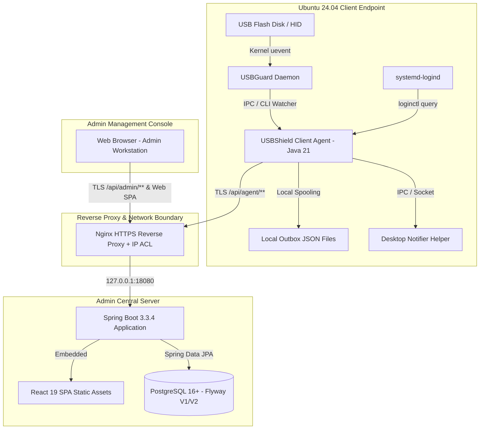

# USBShield Ubuntu — Hướng dẫn Lập trình và Đóng góp Code (Developer Coding Guide)

> **Mục đích tài liệu:** Cung cấp hướng dẫn toàn diện từ kiến trúc, chuẩn coding, luồng phát triển tính năng, kiểm thử đến quy trình debug cho các lập trình viên tham gia phát triển dự án **USBShield Ubuntu** (`admin-server`, `client-agent`, `frontend`, và `packaging`).  
> **Tài liệu tham chiếu liên quan:**
> - [docs/RUN_GUIDE.md](file:///d:/CNTT-SGU/HK7/Seminar/USBProtection/docs/RUN_GUIDE.md) (Hướng dẫn cài đặt, cấu hình môi trường & vận hành hệ thống)
> - [docs/ARCHITECTURE.md](file:///d:/CNTT-SGU/HK7/Seminar/USBProtection/docs/ARCHITECTURE.md) (Tài liệu kiến trúc hệ thống cốt lõi)
> - [docs/API.md](file:///d:/CNTT-SGU/HK7/Seminar/USBProtection/docs/API.md) & [docs/API_PHASE1_TO_PHASE3_ADDENDUM.md](file:///d:/CNTT-SGU/HK7/Seminar/USBProtection/docs/API_PHASE1_TO_PHASE3_ADDENDUM.md) (Quy chuẩn API hợp đồng)
> - [docs/AGENT_SERVER_PROTOCOL.md](file:///d:/CNTT-SGU/HK7/Seminar/USBProtection/docs/AGENT_SERVER_PROTOCOL.md) (Giao thức truyền thông Agent — Server)

---

## 1. Tổng quan hệ thống và Cấu trúc Mã nguồn

### 1.1. Bức tranh kiến trúc đa thành phần

USBShield là hệ thống bảo mật Endpoint tập trung quản lý thiết bị USB Flash Disk trên Ubuntu 24.04 LTS, gồm 4 phân hệ chính:



### 1.2. Các nguyên tắc kỹ thuật cốt lõi (Core Invariants)

Bất kỳ đoạn code nào được viết hoặc chỉnh sửa trong dự án đều phải tuân thủ nghiêm ngặt 5 nguyên tắc sau:

1. **Fail-Closed Principle (Mặc định chặn):**
   - Thiết bị USB Mass Storage (Interface class `08`) chưa được cấp phép luôn luôn bị chặn bởi USBGuard.
   - Khi mất kết nối mạng hoặc Agent gặp sự cố, USBGuard daemon trên máy trạm vẫn thực thi chính sách đã lưu cục bộ (`/etc/usbguard/rules.conf`). Thiết bị chưa cấp phép không được tự động mở trong bất kỳ tình huống lỗi nào.
   - Chuột/bàn phím (HID - class `03`) hoạt động bình thường theo quy tắc cơ sở `allow with-interface none-of { 08:*:* }`.
2. **Per-Endpoint Whitelist (Không dùng Global Whitelist):**
   - Không tồn tại khái niệm "Allow cho toàn bộ hệ thống". Mỗi quyền cấp phép (Whitelist Entry) gắn chặt với một cặp: `(endpoint_id, device_hash/fingerprint)`.
   - Một USB được phép cắm ở máy A tuyệt đối không được tự động cho phép ở máy B trừ khi có bản ghi cấp phép riêng cho máy B.
3. **Active User Attribution (Định danh người dùng tại thời điểm sự kiện):**
   - Ghi nhận thông tin phiên làm việc đồ họa local đang active tại thời điểm cắm USB (`linuxUsername`, `linuxUid`, `sessionId`, `sessionType`, `seat`).
   - **Quy tắc không đoán mò (No-guessing):** Nếu không thể xác định duy nhất phiên local active (máy đang lock screen, có nhiều session SSH, hoặc không có session đồ họa), hệ thống **bắt buộc** gán nhãn `UNKNOWN`.
4. **Tách biệt phân quyền (Role & Credential Separation):**
   - Admin routes (`/api/admin/**`, `/api/auth/**`): Yêu cầu Cookie Session của Spring Security + CSRF Token Header (`X-XSRF-TOKEN`).
   - Agent routes (`/api/agent/**`): Yêu cầu định danh qua Header `X-Endpoint-Id` và Token bí mật qua `X-Agent-Token`.
   - Tuyệt đối không cho phép dùng Session Admin để gọi API Agent hoặc dùng Agent Token để gọi API Admin.
5. **Đồng bộ trạng thái chính sách hai pha (Desired vs Applied Policy):**
   - Khi Admin cấp phép/thu hồi (Allow/Revoke), Server tăng `policyVersion` (Desired Version).
   - Agent kéo chính sách mới về qua Heartbeat, nạp vào USBGuard thành công thì mới gửi bản tin ACK (`/api/agent/policy/ack`). Khi đó Server mới cập nhật `appliedPolicyVersion`.
   - Người dùng phải **rút USB ra cắm lại** để áp dụng chính sách mới.

### 1.3. Cấu trúc cây thư mục dự án

```
USBProtection/
├── admin-server/                  # Backend Spring Boot 3
│   ├── src/main/java/             # Source code Java (Controllers, Services, Repositories, Entities)
│   ├── src/main/resources/        # application.yml, db/migration (Flyway V1, V2)
│   ├── src/test/java/             # Integration tests, Unit tests, MockMvc suites
│   ├── pom.xml                    # Maven POM (Spring Boot 3.3.4, Java 21)
│   └── build-release.ps1          # Script build JAR kèm frontend tĩnh & manifest
├── client-agent/                  # Daemon chạy trên máy trạm Ubuntu
│   ├── src/main/java/             # Agent daemon, UsbGuard watcher, loginctl session resolver
│   ├── src/test/java/             # Unit tests (Mock Gateway, Outbox tests)
│   └── pom.xml                    # Maven POM độc lập
├── frontend/                      # Admin Web Console (React 19, TypeScript, Vite)
│   ├── src/                       # Components, Pages, Hooks, Services, Types
│   ├── tests/                     # Node.js native test runner test suites
│   └── package.json               # NPM scripts, dependencies (React 19, Vite 8, Oxlint)
├── packaging/                     # Đóng gói và triển khai Ubuntu
│   ├── agent-deb/                 # Cấu trúc Debian package (DEBIAN/postinst, rules)
│   ├── nginx/                     # Mẫu cấu hình reverse proxy HTTPS + ACL IP
│   ├── scripts/                   # build-deb.ps1, build-deb.sh
│   └── tests/                     # verify-windows.ps1 (Bộ test tổng hợp trên Windows)
├── scripts/                       # Tiện ích môi trường (with-env.ps1)
└── docs/                          # Tài liệu kiến trúc, đặc tả API, hướng dẫn vận hành
```

---

## 2. Thiết lập Môi trường Phát triển (Local Dev Setup)

### 2.1. Yêu cầu công cụ và phiên bản chuẩn

| Công cụ | Phiên bản yêu cầu | Ghi chú |
|---|---|---|
| **OS** | Windows 11 / Ubuntu 24.04 LTS | Dev backend/frontend chạy tốt trên Windows; Agent đầy đủ cần Ubuntu 24.04 |
| **JDK** | Java 21 hoặc 22 (LTS) | Khuyến nghị OpenJDK 21 / Oracle JDK 22.0.2. **Lưu ý:** JDK 24 chưa hỗ trợ Lombok 1.18.36 |
| **Maven** | 3.9+ | Trình quản lý dependency và build Java |
| **Node.js** | 22.x+ (Khuyến nghị 22.19+) | Dùng để chạy Frontend và bộ test Node |
| **npm** | 10.9+ | Trình quản lý package Frontend |
| **PostgreSQL** | 16+ | Cơ sở dữ liệu chính của hệ thống |
| **PowerShell** | 7.4+ (Khuyến nghị 7.6+) | Bắt buộc để chạy các script kiểm thử tự động trên Windows (`pwsh.exe`) |

### 2.2. Cấu hình biến môi trường và file `.env`

Để bảo mật, dự án không commit mật khẩu hoặc bí mật môi trường vào Git. Khi lập trình cục bộ:
1. Sao chép `.env.example` thành `.env` tại thư mục gốc của repository.
2. Cung cấp các giá trị cho môi trường dev và môi trường test độc lập:

```env
# Database ứng dụng cục bộ
USBSHIELD_DB_URL=jdbc:postgresql://localhost:5432/usbshield
USBSHIELD_DB_USERNAME=usbshield
USBSHIELD_DB_PASSWORD=your_dev_password

# Database chạy Integration Tests (BẮT BUỘC RIÊNG BIỆT)
USBSHIELD_TEST_DB_HOST=localhost
USBSHIELD_TEST_DB_PORT=5432
USBSHIELD_TEST_DB_USERNAME=usbshield_test
USBSHIELD_TEST_DB_PASSWORD=your_test_password

# Thông tin bootstrap Admin ban đầu
USBSHIELD_ADMIN_USERNAME=admin
USBSHIELD_ADMIN_PASSWORD=AdminSecurePassword123!

# Token cấp phát ban đầu cho Agent đăng ký (Enrollment)
USBSHIELD_ENROLLMENT_TOKEN=BootstrapEnrollmentSecretToken2026
```

> [!CAUTION]
> **Quy tắc cách ly Database Test:** Tuyệt đối không trỏ biến `USBSHIELD_TEST_DB_*` vào database chạy chính `usbshield`. Bộ test sẽ tự động tạo và xóa các schema `usbshield_it_*` và `usbshield_e2e_*`.

Để chạy lệnh nạp biến từ `.env` an toàn trên Windows, sử dụng wrapper:
```powershell
./scripts/with-env.ps1 -Command { mvn -f admin-server/pom.xml test }
```

### 2.3. Khởi tạo Cơ sở dữ liệu PostgreSQL cho Dev

Đăng nhập PostgreSQL bằng quyền superuser (`postgres`) và khởi tạo 2 database cùng 2 role riêng biệt:

```sql
-- 1. Database & User cho ứng dụng dev
CREATE USER usbshield WITH PASSWORD 'your_dev_password';
CREATE DATABASE usbshield OWNER usbshield;
GRANT ALL PRIVILEGES ON DATABASE usbshield TO usbshield;

-- 2. Database & User cho kiểm thử tự động (Integration Tests & Browser Live)
CREATE USER usbshield_test WITH PASSWORD 'your_test_password';
CREATE DATABASE usbshield_test OWNER usbshield_test;
CREATE DATABASE usbshield_browser_test OWNER usbshield_test;
GRANT ALL PRIVILEGES ON DATABASE usbshield_test TO usbshield_test;
GRANT ALL PRIVILEGES ON DATABASE usbshield_browser_test TO usbshield_test;

-- Cho phép role test tạo schema tự do trong test database
\c usbshield_test
GRANT ALL ON SCHEMA public TO usbshield_test;
ALTER DEFAULT PRIVILEGES IN SCHEMA public GRANT ALL ON TABLES TO usbshield_test;

\c usbshield_browser_test
GRANT ALL ON SCHEMA public TO usbshield_test;
ALTER DEFAULT PRIVILEGES IN SCHEMA public GRANT ALL ON TABLES TO usbshield_test;
```

### 2.4. Khởi chạy từng service độc lập trong môi trường Dev

#### A. Khởi chạy Backend Admin Server
```powershell
cd admin-server
$env:USBSHIELD_DB_PASSWORD = "your_dev_password"
$env:USBSHIELD_ADMIN_USERNAME = "admin"
$env:USBSHIELD_ADMIN_PASSWORD = "AdminSecurePassword123!"
$env:USBSHIELD_ENROLLMENT_TOKEN = "BootstrapEnrollmentSecretToken2026"

mvn spring-boot:run
```
- Server lắng nghe tại: `http://127.0.0.1:8080`.
- Swagger / OpenAPI UI: `http://127.0.0.1:8080/swagger-ui.html` (chỉ mở ở profile `default`, tự động tắt khi chạy `prod`).

#### B. Khởi chạy Frontend React Dev Server
```powershell
cd frontend
npm ci
npm run dev
```
- Vite Dev Server lắng nghe tại `http://localhost:5173`.
- File [vite.config.ts](file:///d:/CNTT-SGU/HK7/Seminar/USBProtection/frontend/vite.config.ts) đã được cấu hình proxy `/api` về `http://127.0.0.1:8080`, đảm bảo trình duyệt xử lý cookie session và CSRF giống hệt môi trường production cùng origin.

#### C. Khởi chạy Client Agent trên môi trường Dev (Windows)
Khi chạy trên Windows, `AdaptiveUsbGuardGateway` và `AdaptiveActiveUserResolver` sẽ tự động nhận diện hệ điều hành không phải Linux và chuyển sang chế độ **Mock**:
```powershell
cd client-agent
$env:USBSHIELD_SERVER_URL = "http://127.0.0.1:8080"
$env:USBSHIELD_ENROLLMENT_TOKEN = "BootstrapEnrollmentSecretToken2026"

mvn spring-boot:run
```

---

## 3. Hướng dẫn Code cho Từng Phân Hệ

### 3.1. Phân hệ Admin Server (`admin-server/`)

#### Kiến trúc phân tầng (Layered Architecture):
Mã nguồn đặt trong package `com.group.usbshield.server`:
- `auth/`: Xác thực Admin, đổi mật khẩu, cơ chế phiên bản hóa thông tin xác thực (`credential_version`).
- `agentapi/`: Các endpoint giao tiếp với Agent (`/api/agent/**`).
- `endpoint/`: Quản lý danh sách Endpoint, trạng thái kết nối, thông tin máy trạm.
- `policy/`: Nghiệp vụ Whitelist, phiên bản chính sách (`EndpointPolicyService`).
- `event/`: Tiếp nhận, deduplicate và lưu trữ sự kiện cắm/rút USB.
- `config/`: Cấu hình Spring Security, CORS, OpenAPI, Exception Handler.

#### Luồng xử lý một Request chuẩn:
```
HTTP Request 
   ├──> Spring Security Filters (Kiểm tra Session/CSRF hoặc Agent Token Header)
   ├──> Controller (Validate DTO bằng @Valid)
   ├──> Service (Chứa nghiệp vụ, @Transactional)
   ├──> Repository (Spring Data JPA Interface)
   └──> PostgreSQL (Flyway managed tables)
```

#### Quy tắc bảo mật xác thực (Security Authentication):
Xem [SecurityConfig.java](file:///d:/CNTT-SGU/HK7/Seminar/USBProtection/admin-server/src/main/java/com/group/usbshield/server/config/SecurityConfig.java) và [AgentAuthenticationFilter.java](file:///d:/CNTT-SGU/HK7/Seminar/USBProtection/admin-server/src/main/java/com/group/usbshield/server/agentapi/AgentAuthenticationFilter.java):
1. **Agent Request:** Phải chứa 2 header bắt buộc:
   - `X-Endpoint-Id`: Định danh endpoint (UUID dạng chuỗi).
   - `X-Agent-Token`: Token bí mật trả về khi enrollment.
   - Filter sẽ băm token bằng BCrypt và đối chiếu với trường `agent_token_hash` trong bảng `endpoints`. Nếu sai hoặc không khớp `endpoint_id`, trả về `401 Unauthorized` ngay lập tức.
2. **Admin Request:**
   - Dùng Session Cookie (`JSESSIONID`).
   - Mọi phương thức thay đổi trạng thái (`POST`, `PUT`, `DELETE`) **bắt buộc** có header `X-XSRF-TOKEN` khớp với cookie CSRF do server sinh ra.

#### Pessimistic Locking trong cập nhật chính sách:
Khi thay đổi whitelist hoặc nhận ACK chính sách, để tránh race condition giữa các thread hoặc nhiều request đồng thời, bắt buộc dùng khóa bi quan (`PESSIMISTIC_WRITE`) trên dòng `Endpoint`:
```java
// Trong EndpointPolicyService.java
@Transactional
public EndpointPolicyResponse allowDevice(String endpointId, AllowDeviceRequest request) {
    // Khóa bản ghi Endpoint để tuần tự hóa các thay đổi policy_version
    Endpoint endpoint = endpointRepository.findByEndpointIdForUpdate(endpointId)
        .orElseThrow(() -> new ResourceNotFoundException("Endpoint not found"));
    
    // Thêm whitelist entry và tăng policy_version
    endpoint.setPolicyVersion(endpoint.getPolicyVersion() + 1);
    endpointRepository.save(endpoint);
    ...
}
```

#### Quy tắc viết Flyway Migration:
- Thư mục: `admin-server/src/main/resources/db/migration/`.
- Định dạng tên file: `V<Version>__<Mo_ta_ngan_gon>.sql` (2 dấu gạch dưới).
- **Tuyệt đối không dùng `DROP TABLE` hoặc `TRUNCATE`** trong migration lịch sử.
- Khi thêm cột mới, luôn dùng `ADD COLUMN IF NOT EXISTS` để hỗ trợ tương thích ngược.

---

### 3.2. Phân hệ Client Agent (`client-agent/`)

#### Tương tác với Linux Subsystem & Kiến trúc Thích ứng (Adaptive):
Agent chạy nền dưới quyền `root` (systemd service) trên Ubuntu. Để dev có thể chạy và test trên cả Windows lẫn Ubuntu, hệ thống sử dụng mẫu thiết kế **Adaptive/Gateway**:
- [UsbGuardGateway](file:///d:/CNTT-SGU/HK7/Seminar/USBProtection/client-agent/src/main/java/com/group/usbshield/agent/usbguard/UsbGuardGateway.java):
  - [UsbGuardCliGateway.java](file:///d:/CNTT-SGU/HK7/Seminar/USBProtection/client-agent/src/main/java/com/group/usbshield/agent/usbguard/UsbGuardCliGateway.java): Thực thi lệnh native `usbguard list-devices`, `usbguard append-rule`, `usbguard watch`.
  - [MockUsbGuardGateway.java](file:///d:/CNTT-SGU/HK7/Seminar/USBProtection/client-agent/src/main/java/com/group/usbshield/agent/usbguard/MockUsbGuardGateway.java): Giả lập thiết bị USB và quy tắc khi chạy trên Windows/Test.
- [ActiveUserResolver](file:///d:/CNTT-SGU/HK7/Seminar/USBProtection/client-agent/src/main/java/com/group/usbshield/agent/session/ActiveUserResolver.java):
  - [LoginctlActiveUserResolver.java](file:///d:/CNTT-SGU/HK7/Seminar/USBProtection/client-agent/src/main/java/com/group/usbshield/agent/session/LoginctlActiveUserResolver.java): Phân tích output từ `loginctl list-sessions` và `loginctl show-session <id>`.
  - Nhận diện trạng thái: Phiên đồ họa (`wayland`/`x11`), đang active trên `seat0`. Nếu có nhiều hơn 1 user hoặc không có session active, trả về `ActiveUserInfo.UNKNOWN`.

#### Cơ chế Lưu trữ Ngoại tuyến (Offline Spooling - Outbox):
Xem [OutboxSpoolService.java](file:///d:/CNTT-SGU/HK7/Seminar/USBProtection/client-agent/src/main/java/com/group/usbshield/agent/outbox/OutboxSpoolService.java):
1. Khi phát hiện sự kiện cắm/rút USB, Agent tạo file JSON trong thư mục spool:
   `event_<timestamp>_<uuid>.json`.
2. Ghi file an toàn: Ghi vào file tạm, sau đó thực hiện **Atomic Move / Rename** để đảm bảo không bị corrupt dữ liệu khi mất nguồn đột ngột.
3. Luồng nền định kỳ (hoặc khi có mạng trở lại) sẽ đọc các file theo thứ tự thời gian (`timestamp`), gửi lên Admin Server và xóa file sau khi Server phản hồi `200 OK`.
4. Nếu payload bị lỗi cú pháp hoặc Server từ chối vĩnh viễn (400), file được chuyển sang thư mục `quarantine/` để tránh nghẽn hàng đợi (poison message).

---

### 3.3. Phân hệ Frontend (`frontend/`)

#### Cấu trúc thư mục mã nguồn:
```
frontend/src/
├── components/          # Reusable UI components (DataTable, Modal, Toast, Badge)
│   ├── endpoint/        # Các component chuyên cho Endpoint (DetailModal, StatusBadge)
│   └── event/           # Các component hiển thị sự kiện (EventTable, EventFilters)
├── hooks/               # Custom React Hooks (useAuth, useRoute, useToast, useResource)
├── layouts/             # Layout giao diện chính (AdminLayout, Sidebar, Navbar)
├── pages/               # Trang ứng dụng (Dashboard, Endpoints, Events, Login)
├── services/            # Layer giao tiếp API (api.ts, http.ts, models.ts, mappers/)
├── types/               # TypeScript interface và type definitions
└── utils/               # Hàm tiện ích format ngày giờ, device name
```

#### Quy tắc gọi API và xử lý CSRF:
- Tất cả request gọi qua [http.ts](file:///d:/CNTT-SGU/HK7/Seminar/USBProtection/frontend/src/services/http.ts) hoặc [api.ts](file:///d:/CNTT-SGU/HK7/Seminar/USBProtection/frontend/src/services/api.ts).
- Client tự động trích xuất cookie `XSRF-TOKEN` từ document.cookie và đính kèm vào header `X-XSRF-TOKEN` cho các request `POST`, `PUT`, `DELETE`.
- Tuyệt đối không hardcode URL backend (`http://localhost:8080`) trong code frontend. Luôn dùng relative path `/api/...` để Vite proxy trong lúc dev và dùng chung origin trong lúc production.

#### Quy chuẩn xử lý trạng thái & UI:
- Không reload trang khi cập nhật dữ liệu. Sử dụng hook `useResource` hoặc state management để cập nhật lạc quan (optimistic) hoặc re-fetch danh sách.
- Đối với danh sách Endpoint và Event, luôn sử dụng API phân trang (`/api/admin/endpoints/page` và `/api/admin/events`). Bắt buộc truyền `page` và `size` để tránh tải quá nhiều dữ liệu gây chậm trình duyệt.

---

## 4. Quy chuẩn Viết Code & Best Practices (Coding Conventions)

### 4.1. Quy chuẩn đặt tên (Naming Conventions)

| Đối tượng | Quy tắc | Ví dụ |
|---|---|---|
| **Java Class / Interface** | PascalCase, danh từ hoặc tính từ | `EndpointPolicyService`, `UsbEventPayload` |
| **Java Method / Variable** | camelCase | `syncPolicy()`, `appliedPolicyVersion` |
| **Java Constant** | UPPER_SNAKE_CASE | `DEFAULT_OFFLINE_AFTER_SECONDS` |
| **Database Table** | snake_case, số nhiều | `admin_users`, `endpoint_whitelist_entries` |
| **Database Column** | snake_case | `endpoint_id`, `policy_version` |
| **REST API Path** | kebab-case hoặc noun plural | `/api/admin/endpoints/{id}/whitelist` |
| **TypeScript Type / Interface** | PascalCase | `EndpointSummary`, `UsbDeviceDto` |
| **React Component** | PascalCase | `EndpointDetailModal.tsx` |
| **React Hook** | camelCase, tiền tố `use` | `useAuth.ts`, `useResource.ts` |

### 4.2. DTO & Validation Layer

- **Không bao giờ trả Entity JPA trực tiếp ra ngoài Controller API.** Luôn map sang DTO (Data Transfer Object) để tránh lộ trường nhạy cảm (`agent_token_hash`, `password_hash`) hoặc gây lỗi vòng lặp tuần tự hóa JSON do lazy-loading.
- Mọi dữ liệu đầu vào từ Controller phải được kiểm tra qua Bean Validation:
  ```java
  public record AllowDeviceRequest(
      @NotBlank(message = "Vendor ID is required")
      @Pattern(regexp = "^[0-9a-fA-F]{4}$", message = "Vendor ID must be 4 hex chars")
      String vendorId,

      @NotBlank(message = "Product ID is required")
      @Pattern(regexp = "^[0-9a-fA-F]{4}$", message = "Product ID must be 4 hex chars")
      String productId,

      @NotBlank(message = "Device hash is required")
      String deviceHash
  ) {}
  ```

### 4.3. Quản lý Exception & HTTP Status Codes

Hệ thống sử dụng [ApiExceptionHandler.java](file:///d:/CNTT-SGU/HK7/Seminar/USBProtection/admin-server/src/main/java/com/group/usbshield/server/common/ApiExceptionHandler.java) để chuyển đổi exception thành định dạng JSON chuẩn:

```json
{
  "timestamp": "2026-11-20T11:45:00Z",
  "status": 400,
  "error": "Bad Request",
  "message": "Vendor ID must be 4 hex chars",
  "path": "/api/admin/endpoints/ep-01/whitelist"
}
```

Bảng mã lỗi chuẩn cần trả về:
- `400 Bad Request`: Dữ liệu đầu vào không hợp lệ hoặc payload sai định dạng.
- `401 Unauthorized`: Thiếu hoặc sai thông tin xác thực (Agent Token hoặc Admin Session).
- `403 Forbidden`: Quyền không đủ, sai token CSRF, hoặc Agent này cố tình truy cập tài nguyên của Agent khác.
- `404 Not Found`: Không tìm thấy Endpoint, Device hoặc Whitelist entry.
- `409 Conflict`: Xung đột dữ liệu (Ví dụ: Đăng ký trùng `machine_id`, ACK policy version cũ hơn version hiện tại).

### 4.4. Quy chuẩn Logging & Bảo mật thông tin

> [!WARNING]
> **Tuyệt đối không log các thông tin sau:**
> 1. Mật khẩu dạng rõ (plaintext password) hoặc chuỗi token (`agent_token`, `enrollment_token`).
> 2. Khóa hash của token/password.
> 3. Tên người dùng và serial USB không được ghi vào mức log `INFO` trong các luồng xử lý thông thường (chỉ ghi `endpoint_id` và `event_id`).

**Đúng chuẩn:**
```java
// TỐT: Log ngắn gọn, đủ thông tin truy vết không nhạy cảm
log.info("Agent event processed successfully: endpointId={}, eventId={}, decision={}",
    request.getEndpointId(), request.getEventId(), request.getDecision());

// VI PHẠM: Lộ token bí mật trong log
log.debug("Agent authentication header token: {}", rawToken); // CẤM!
```

---

## 5. Hướng dẫn Thực chiến: Cách Thêm Một Tính Năng Mới

Giả sử bạn cần thêm một tính năng: **"Bổ sung trường ghi chú lý do cấp phép (`allow_reason`) khi Admin thêm USB vào Whitelist"**. Dưới đây là các bước chuẩn theo vòng đời mã nguồn USBShield:

### Bước 1: Viết Flyway Migration (Backend Database)
Tạo file migration mới tại `admin-server/src/main/resources/db/migration/V3__add_whitelist_allow_reason.sql`:
```sql
ALTER TABLE endpoint_whitelist_entries
    ADD COLUMN IF NOT EXISTS allow_reason varchar(255);
```

### Bước 2: Cập nhật Entity & DTO (Admin Server)
1. Thêm trường `allowReason` vào [EndpointWhitelistEntry.java](file:///d:/CNTT-SGU/HK7/Seminar/USBProtection/admin-server/src/main/java/com/group/usbshield/server/policy/EndpointWhitelistEntry.java):
   ```java
   @Column(name = "allow_reason", length = 255)
   private String allowReason;
   ```
2. Cập nhật DTO tiếp nhận request:
   ```java
   public record AllowDeviceRequest(
       ...
       @Size(max = 255, message = "Allow reason must not exceed 255 characters")
       String allowReason
   ) {}
   ```
3. Cập nhật `EndpointPolicyService` để lưu trường này và tăng `policyVersion`.

### Bước 3: Cập nhật Frontend UI
1. Mở [models.ts](file:///d:/CNTT-SGU/HK7/Seminar/USBProtection/frontend/src/services/models.ts) và [types.ts](file:///d:/CNTT-SGU/HK7/Seminar/USBProtection/frontend/src/types.ts), thêm thuộc tính:
   ```typescript
   export interface WhitelistItem {
     id: number;
     endpointId: string;
     deviceHash: string;
     allowReason?: string;
     createdAt: string;
   }
   ```
2. Thêm ô nhập liệu "Lý do cấp phép" vào `EndpointWhitelistPanel.tsx` khi Admin bấm nút Allow.
3. Hiển thị cột `Lý do` trên bảng danh sách Whitelist.

### Bước 4: Kiểm thử tính năng (Testing)
1. Viết Unit Test cho Service: Kiểm tra lưu đúng `allowReason` và tăng `policyVersion`.
2. Chạy Frontend Lint & Test: `npm run lint` và `npm test`.
3. Kiểm thử tích hợp: Khởi chạy backend và thao tác trên giao diện Web.

---

## 6. Chiến lược Kiểm thử (Testing & QA)

Dự án áp dụng mô hình kiểm thử phân lớp chặt chẽ:

### 6.1. Backend Tests (`admin-server/`)
- **Unit Tests:** Kiểm tra logic nghiệp vụ thuần túy bằng Mockito, không cần bật database.
- **Integration Tests:** Bật Spring Context với PostgreSQL thật.
  - Sử dụng schema cách ly: Mỗi class test dùng một schema ngẫu nhiên `usbshield_it_*` trong database `usbshield_test` do Flyway tự tạo và tự xóa sau khi chạy xong.
  - Chạy toàn bộ backend test:
    ```powershell
    mvn -f admin-server/pom.xml clean test
    ```

### 6.2. Frontend Tests (`frontend/`)
Frontend sử dụng bộ test runner của Node.js kết hợp Oxlint để kiểm tra tĩnh cực nhanh:
```powershell
cd frontend
# 1. Kiểm tra cú pháp và quy chuẩn TypeScript/React
npm run lint

# 2. Chạy bộ unit test của các component và mappers
npm test
```

### 6.3. Client Agent Tests (`client-agent/`)
- Kiểm tra tính đúng đắn của logic phân tích USBGuard rule (`UsbGuardEventParserTest`).
- Kiểm tra cơ chế hàng đợi Outbox spooling (`OutboxSpoolServiceTest`).
- Chạy test Agent trên Windows:
  ```powershell
  mvn -f client-agent/pom.xml clean test
  ```
  *(Lưu ý: 3 test phụ thuộc vào môi trường native Linux thật sẽ tự động SKIP khi chạy trên Windows, điều này hoàn toàn bình thường).*

### 6.4. Bộ kiểm thử tự động toàn diện trên Windows (`verify-windows.ps1`)

Trước khi tạo Pull Request hoặc phát hành bản release, hãy chạy script kiểm thử tự động toàn diện của dự án:
```powershell
pwsh -File ./packaging/tests/verify-windows.ps1
```
Script này sẽ tự động:
1. Kiểm tra tính toàn vẹn của mã nguồn và các file cấu hình.
2. Chạy toàn bộ test của `admin-server` và `client-agent`.
3. Chạy `oxlint`, `build` và test của `frontend`.
4. Đóng gói static web vào JAR Admin Server và chạy HTTP Live smoke test.
5. Kiểm tra quy trình đóng gói `.deb` của Client Agent.

---

## 7. Quy trình Làm việc với Git & Release

### 7.1. Quy ước Nhánh (Branching Strategy)
- `main` / `master`: Nhánh production, luôn ở trạng thái build pass và có thể deploy.
- `feature/<ten-tinh-nang>`: Nhánh phát triển tính năng mới.
- `fix/<ma-loi>`: Nhánh sửa lỗi.

### 7.2. Quy ước Commit Message
Tuân thủ Conventional Commits:
- `feat: add reason field to whitelist entry`
- `fix: resolve stale session resolution in ActiveUserResolver`
- `docs: update developer coding guide`
- `test: add integration test for agent policy ack`

### 7.3. Checklist trước khi tạo Pull Request (Pre-PR Checklist)
- [ ] Mã nguồn đã được format sạch sẽ, không có import thừa.
- [ ] Không có file nhạy cảm (`.env`, mật khẩu, certificate private key) bị thêm vào Git (`git status`).
- [ ] `mvn clean test` trên cả `admin-server` và `client-agent` đều PASS.
- [ ] `npm run lint` và `npm test` trên `frontend` đều PASS.
- [ ] Đã thêm Migration script nếu có thay đổi bảng trong cơ sở dữ liệu.

---

## 8. Xử lý Sự cố Thường gặp khi Lập trình (Troubleshooting)

### 1. Lỗi Lombok không compile được (`Fatal error compiling ... TypeTag :: UNKNOWN`)
- **Nguyên nhân:** Đang sử dụng JDK 24+. Phiên bản Lombok 1.18.36 trong dự án chưa tương thích với JDK 24.
- **Khắc phục:** Trỏ biến môi trường `JAVA_HOME` về JDK 21 hoặc JDK 22 trước khi build:
  ```powershell
  $env:JAVA_HOME = "C:\Program Files\Java\jdk-21"
  $env:Path = "$env:JAVA_HOME\bin;$env:Path"
  ```

### 2. Lỗi Flyway: `Found non-empty schema(s) "public" but no schema history table`
- **Nguyên nhân:** Database PostgreSQL đã có sẵn các bảng từ trước nhưng chưa được quản lý bởi Flyway.
- **Khắc phục:** Đối với database dev mới, hãy drop database và tạo lại sạch sẽ. Đối với database đã có dữ liệu quan trọng, xem tài liệu [POSTGRES_FLYWAY_BASELINE.md](file:///d:/CNTT-SGU/HK7/Seminar/USBProtection/admin-server/ops/POSTGRES_FLYWAY_BASELINE.md) để chạy baseline.

### 3. Lỗi 403 Forbidden khi gọi API Admin từ Frontend
- **Nguyên nhân:** Thiếu cookie session hoặc thiếu header `X-XSRF-TOKEN`.
- **Khắc phục:** Đảm bảo bạn đã đăng nhập qua `/api/auth/login` trước. Khi dùng Postman hoặc code custom, phải copy giá trị của cookie `XSRF-TOKEN` vào header `X-XSRF-TOKEN` của request.

### 4. Agent gặp lỗi 409 Conflict khi Enrollment
- **Nguyên nhân:** Máy trạm (`machine_id`) này đã từng đăng ký với server trước đó. Hệ thống không cho phép tự động ghi đè token để tránh giả mạo endpoint.
- **Khắc phục:** Trong môi trường dev, xóa dòng endpoint tương ứng trong bảng `endpoints` của database, hoặc cấu hình `machine_id` giả lập mới trong cấu hình Agent.
